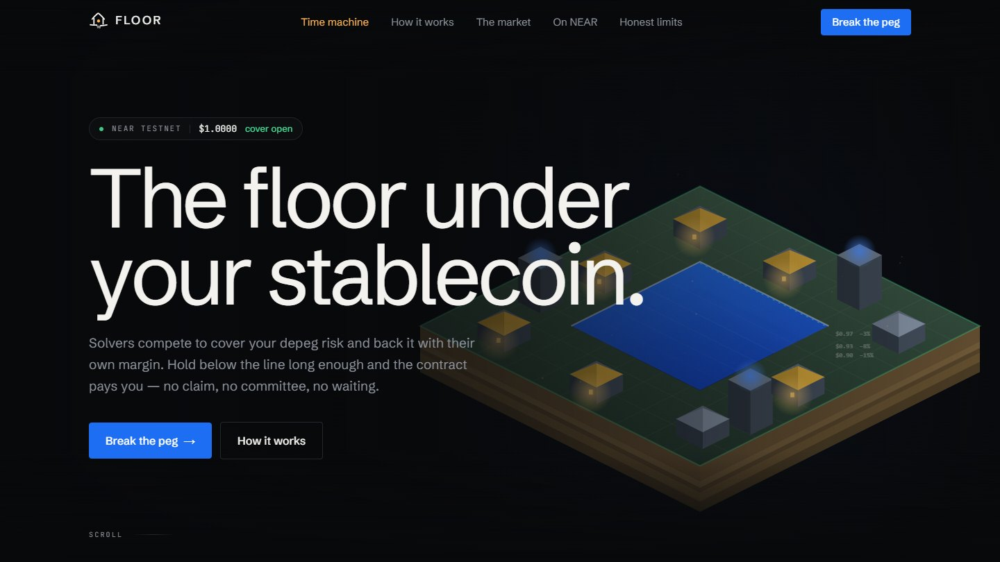
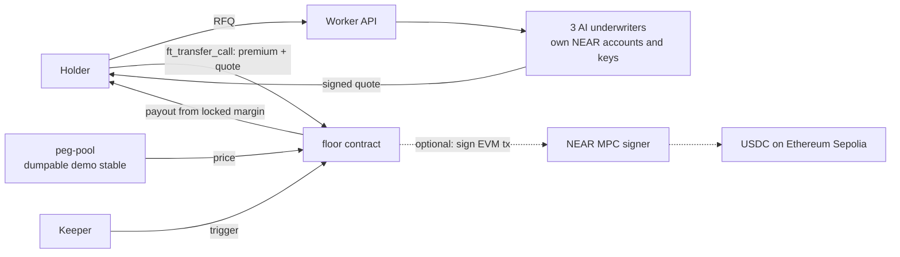

# Floor

[](https://github.com/anuraggdubey/floor/actions/workflows/ci.yml)


[](LICENSE)

**Stablecoin depeg cover that pays itself.** AI underwriters compete to back your cover with their own locked margin. NEAR contracts verify every quote, enforce the rules, and pay you automatically when the peg breaks: no claim form, no committee. Built for **NEAR HACKATHON 2026**.

In March 2023 USDC fell to about $0.87 and holders had no cover they could buy in time. Pooled crypto cover stays small because capital is scarce and risk is hard to price. Floor turns underwriting into a live competition and moves enforcement into contracts.

| | |
|---|---|
| **Live demo** | https://floorxa.vercel.app |
| **Demo video** | [Watch on Google Drive](https://drive.google.com/file/d/1lYvC4qibnEfpz2RJsUkKGYo7O_NRkApu/view?usp=sharing) |
| **Demo post on X** | [Post on X](https://x.com/anuraggdubeyy/status/2121463325758525504) |
| **Backend health** | https://floor-p17j.onrender.com/api/health |
| **Network** | NEAR testnet, plus Ethereum Sepolia for the cross-chain payout |
| **Tracks** | Unstoppable DeFi (main), Open Innovation, Agent Economy |

**Jump to:** [Try it](#try-it-in-2-minutes) · [Why it matters](#why-it-matters) · [How it works](#how-it-works) · [Architecture](#architecture) · [NEAR features](#near-features-used) · [On-chain proof](#on-chain-proof-near-testnet) · [Verify locally](#run-and-verify-it-locally) · [Limits](#scope-and-limits) · [Roadmap](#roadmap)

<table>
  <tr>
    <td width="50%"><br /><sub><b>Landing:</b> the story and a live on-chain price</sub></td>
    <td width="50%"><br /><sub><b>Break the peg:</b> three AI underwriters quote, with reasoning</sub></td>
  </tr>
  <tr>
    <td width="50%"><br /><sub><b>Time machine:</b> the real March 2023 crash, replayed</sub></td>
    <td width="50%"><br /><sub><b>Footer:</b> contracts, sources and stack</sub></td>
  </tr>
</table>

## Try it in 2 minutes
1. Open the live demo, go to **`/play`** (the free backend may need up to a minute to wake; the page says so while it does), and press **Watch it happen** (about 2.5 minutes, fully automatic), or drive it yourself:
2. **Get an account**: a real NEAR testnet account in one click, funded with demo credits. No wallet, no gas.
3. **Get quotes**: three AI underwriters read the live pool price, write their reasoning and sign a quote.
4. **Buy cover**: the contract verifies the signature and locks that underwriter's margin for your policy.
5. **Break the peg**: press 25k three times. Each dump is a real NEAR transaction. The gate closes (a late buyer is refused on-chain with `GATE_CLOSED`), and once the price stays under a payout line the contract **pays you in fUSDC**. Every step links to the NEAR explorer.
6. Optional: register an Ethereum address and the contract also pays real **USDC on Ethereum Sepolia** through NEAR Chain Signatures.

**`/time-machine`** replays the real March 2023 USDC/USDT crash (Binance 15-minute candles) against the same market. It is a simulation on real data; no transaction is made.

## Why it matters
- **The problem has a price tag.** USDC traded near $0.87 in March 2023. Holders using it as treasury or collateral either took the loss or had no cover to buy in time. Depeg cover mostly exists as pooled mutual cover, where capital is scarce, pricing is slow and claims need a vote.
- **The fix is structural.** Underwriters compete on price and put their own margin behind each quote. A contract, not a committee, decides whether the peg broke and who gets paid.
- **Every step is checkable.** Quotes are ed25519 signatures verified in Rust, payouts come from locked margin, and each action is a NEAR transaction you can open.

| | Pooled mutual cover | Oracle-only parametric | **Floor** |
|---|---|---|---|
| Who prices risk | Pool governance, slowly | A fixed formula | Competing underwriters, per quote |
| Who backs a policy | Everyone in a shared pool | A shared pool | One underwriter's locked margin |
| How a claim resolves | Claim, vote, wait | Oracle trigger | Contract trigger on a sustained on-chain price |
| Manipulation guard | Governance | Oracle design | State gate, sustained breach, settlement delay |
| Cross-chain payout | Rare | Rare | USDC on Ethereum Sepolia via Chain Signatures |

A design comparison of approaches, not a claim about any named product.

## How it works
```
holder ──RFQ──▶ worker ──▶ 3 AI underwriters (own NEAR accounts, own margin, own ed25519 quote keys)
holder ◀── best signed quote
holder ──ft_transfer_call(premium + quote)──▶ floor contract
         verifies the ed25519 signature, applies the state gate, locks that underwriter's margin
peg-pool (dumpable demo stable) ──price──▶ floor: breach tracking per tier
price under a tier line for sustain_secs (+ settle_secs) ──▶ anyone calls trigger()
         pays the holder in fUSDC from the locked margin
         optional: asks the NEAR MPC signer to sign a USDC transfer on Ethereum Sepolia
```
- **State gate:** price in band at purchase and activation, a lookback with no breach, and a wait before activation. Late buyers are refused and refunded on-chain.
- **Sustained breach:** a flash dump that recovers pays nothing. A settlement delay stops anyone locking in the shallowest tier by triggering early.
- **AI underwriters:** each is its own NEAR account. The LLM (Groq) only chooses a premium rate, clamped to hard bounds; the contract decides everything that moves money. If the model is slow or unusable, a scripted strategy answers and the offer is labelled `scripted`.

## Architecture

Three Rust contracts hold all money logic. The worker only quotes, polls prices and calls `trigger`; it cannot move funds the contract does not allow.

## NEAR features used
| Feature | Where |
|---|---|
| Own Rust contracts (near-sdk 5) | [`contracts/`](contracts): `fusdc`, `peg-pool`, `floor` |
| NEP-141 with `ft_transfer_call` / `ft_on_transfer` | premiums, margin deposits, refunds |
| `env::ed25519_verify` | `floor` rejects forged and replayed quotes |
| Cross-contract calls and callbacks | price reads, payouts, retry on failure |
| **Chain Signatures (MPC)** | `floor` builds an EVM USDC transfer itself and asks `v1.signer-prod.testnet` to sign it |

## On-chain proof (NEAR testnet)
| Contract | Account | Deployed code hash | Role |
|---|---|---|---|
| `floor` | [`floorxa-floor.testnet`](https://testnet.nearblocks.io/address/floorxa-floor.testnet) | `5rT41JtvjPFyNDAEDo19afjgazR9uvRzcBCE8RZ8ipZr` | cover market: quote verification, gate, triggers, payouts, EVM payout |
| `peg-pool` | [`floorxa-pool.testnet`](https://testnet.nearblocks.io/address/floorxa-pool.testnet) | `9A4xxa9wiF5uyPhA7izEWjme2S77ovZCNxrcJYn4fuW6` | dumpable demo stable pair that the price comes from |
| `fusdc` | [`floorxa-fusdc.testnet`](https://testnet.nearblocks.io/address/floorxa-fusdc.testnet) | `68sTUKw9B3s8bjR3GtkohVtdaduZSXzJke4srhqYqYCk` | NEP-141 demo money |

The hashes are of the build deployed on testnet; check them against the explorer. Later changes on `main` are in the commit history.

Underwriters (`floorxa-solver-a/b/c.testnet`), the keeper, the arbitrage bot and each guest are separate accounts. Read the live state yourself, no keys needed:
```bash
near contract call-function as-read-only floorxa-floor.testnet get_pool_stats json-args '{}' network-config testnet now
near contract call-function as-read-only floorxa-floor.testnet get_policy json-args '{"policy_id":11}' network-config testnet now
```

**One full cycle, policy #11** (100 fUSDC cover from `floorxa-solver-c`, bought by a guest account, 2026-11-12):
| Step | Transaction |
|---|---|
| Buy: signed quote verified, solver margin locked, premium 0.60 | [`CFrqwjyF…xAb3`](https://testnet.nearblocks.io/txns/CFrqwjyFbq2g4yawFXq6eojqbZH9bMEiMCnNxExkAxb3) |
| A late buyer is refused on-chain (`GATE_CLOSED`) and refunded | [`E7NDVYi4…9ykNk`](https://testnet.nearblocks.io/txns/E7NDVYi4tSZedvVtqkf4oi695NBbhGtewSFNinP9ykNk) |
| Sustained breach: `trigger` pays the holder 15.00 fUSDC and reserves a 5 USDC Ethereum payout | [`DMQj7VQH…tJk4`](https://testnet.nearblocks.io/txns/DMQj7VQH5sSx9w1eyX8wagq1uyaJ2Lg9h3sPCpRdtJk4) |
| Cross-chain leg (policy #5): Chain Signatures signs, 5.00 USDC lands on Sepolia | [`0x22fe0094…5b03`](https://sepolia.etherscan.io/tx/0x22fe00940d020c6b0f776445ed102c478e1a4b8bfcbc8425672306095c835b03) |

More transactions and the Chain Signatures sign request are in [`docs/evidence`](docs/evidence).

## What is on-chain, and what is demo scaffolding
**On-chain and verifiable:** the three contracts and their full lifecycle, quote signing (TypeScript) and verification (Rust) with a shared test vector, the fUSDC payout on NEAR, the USDC payout on Ethereum Sepolia through Chain Signatures, and AI underwriters that run as their own NEAR accounts (LLM-driven with `GROQ_API_KEY`, otherwise a scripted strategy, labelled `scripted` in the UI).

**Demo scaffolding, labelled as such in the product:** `fusdc` is demo money and `dUSD` is the demo stable under test, not real USDC. Guest accounts are custodial and testnet only. The time machine is a simulation on real Binance price data.

Every claim has a row in [`docs/CLAIMS.md`](docs/CLAIMS.md) with the command that proves it.

## Run and verify it locally
Linux, macOS or WSL (Windows: use WSL). Needs Rust with the `wasm32-unknown-unknown` target, `cargo-near`, `near-cli-rs`, Node 24, pnpm 10 and `make`.

```bash
make doctor    # toolchain check, every line should say PASS
make setup     # pnpm install
make verify    # offline: contract tests, a local-sandbox lifecycle, worker tests. No keys, no network. Ends with ALL PASS
```
To run the app against NEAR testnet, copy `.env.example` to `.env` and fill it in ([`docs/SETUP.md`](docs/SETUP.md)), then `make worker` (API on :8787) and `make web` (app on :3000). `make e2e` runs the full testnet story (about 4 minutes). To deploy for free on Vercel and Render, see [`docs/DEPLOY.md`](docs/DEPLOY.md).

```
contracts/    Rust NEAR contracts and sandbox integration tests
apps/web      Next.js app: landing, /play, /time-machine
apps/worker   price feed, keeper, underwriters, arbitrage bot, EVM payout executor, HTTP API
docs/         SETUP, DEPLOY, CLAIMS, spikes, evidence, screenshots
scripts/      end-to-end and helper scripts
```

## Roadmap
- Redeploy the latest contract build and refresh the code hashes above.
- Bind the quote signature to the contract account.
- TWAP price source, swap fees and deeper liquidity in place of a spot read.
- Real USDC and a real peg pool with mainnet-grade liquidity.
- Underwriter reputation and margin-efficiency tracking, so better pricers win more flow.
- Inbound Ethereum confirmation, so the cross-chain leg no longer relies on a trusted executor.

## Scope and limits
- Testnet only, demo credits, not regulated insurance. The peg is a demo stable, not USDC; March 2023 is a labelled historical reference.
- Cover is fully collateralised per policy, and fixed partial payouts do not cover a total collapse. The trigger relies on pokes landing inside the sustain window, and the price is a spot read from a pool anyone can trade against, which is why handing out the dump button is safe here. A real version needs a TWAP, deep liquidity and swap fees. A quote signature does not yet bind the contract account, so a quote could in principle be replayed against a second deployment of the same contract.
- The Ethereum leg is outbound only and capped at 5 USDC. The contract cannot read Ethereum, so confirmation comes from a trusted executor, and the MPC committee is a trust assumption.
- Floor runs its own quote flow; it does not claim NEAR's swap solvers underwrite cover. Open items: [`docs/spikes.md`](docs/spikes.md).

## Where each judging question is answered
| Question | Answer |
|---|---|
| Does it work? | [Live demo](https://floorxa.vercel.app), [video](https://drive.google.com/file/d/1lYvC4qibnEfpz2RJsUkKGYo7O_NRkApu/view?usp=sharing), a full cycle in [On-chain proof](#on-chain-proof-near-testnet) |
| Is it technically deep? | Three contracts, in-contract ed25519 and EVM RLP signing, Chain Signatures, cross-contract callbacks |
| Is it NEAR-native? | [NEAR features used](#near-features-used) |
| Is it honest? | [Scope and limits](#scope-and-limits), [`docs/CLAIMS.md`](docs/CLAIMS.md) |
| Can I reproduce it? | `make verify`: offline, no keys |
| Is the AI real? | Groq-driven underwriters, with a labelled `scripted` fallback |

## Built at NEAR HACKATHON 2026
Build window 2026-11-01 to 2026-11-14, no pre-existing baseline code. Claude Code helped write code and docs; the underwriters call an LLM through the Groq API. Third party: near-sdk, near-contract-standards, near-api-js, chainsig.js, viem, Next.js (see lockfiles) and Binance public market data. Keys live only in `.env` and host environment variables, never in git.

## License
MIT, see [`LICENSE`](LICENSE).
