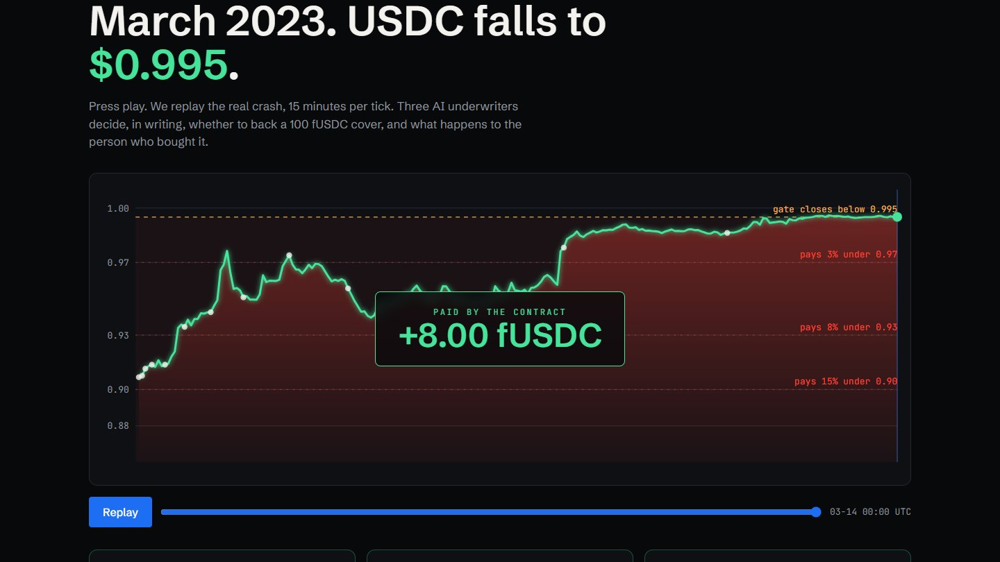
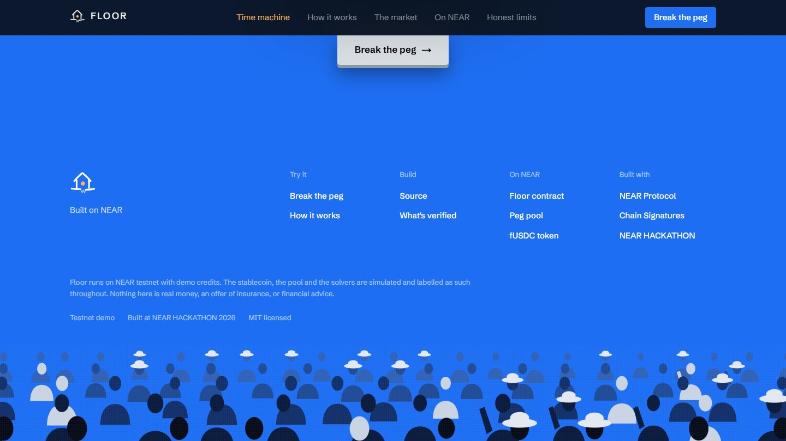

# Floor

**Stablecoin depeg cover that pays itself.** AI underwriters compete to back your cover with their own locked margin. NEAR contracts verify every quote, enforce the rules, and pay you automatically when the peg breaks: no claim form, no committee. Built for **NEAR HACKATHON 2026**.

In March 2023 USDC fell to about $0.87 and holders had no cover they could buy in time. Pooled crypto cover stays small because capital is scarce and risk is hard to price. Floor turns underwriting into a live competition and moves enforcement into contracts.

| | |
|---|---|
| **Live demo** | https://floorxa.vercel.app |
| **Demo video** | [Watch on Google Drive](https://drive.google.com/file/d/1lYvC4qibnEfpz2RJsUkKGYo7O_NRkApu/view?usp=sharing) |
| **Demo post on X** | ADD_X_POST_URL |
| **Network** | NEAR testnet, plus Ethereum Sepolia for the cross-chain payout |
| **Tracks** | Unstoppable DeFi (main), Open Innovation, Agent Economy |

<table>
  <tr>
    <td width="50%"><br /><sub><b>Landing:</b> the story and a live on-chain price</sub></td>
    <td width="50%"><br /><sub><b>Break the peg:</b> three AI underwriters quote, with reasoning</sub></td>
  </tr>
  <tr>
    <td width="50%"><br /><sub><b>Time machine:</b> the real March 2023 crash, replayed</sub></td>
    <td width="50%"><br /><sub><b>Footer:</b> contracts, sources and stack</sub></td>
  </tr>
</table>

## Try it in 2 minutes
1. Open the live demo, go to **`/play`**, and press **Watch it happen** (about 2.5 minutes, fully automatic), or drive it yourself:
2. **Get an account**: a real NEAR testnet account in one click, funded with demo credits. No wallet, no gas.
3. **Get quotes**: three AI underwriters read the live pool price, write their reasoning and sign a quote.
4. **Buy cover**: the contract verifies the signature and locks that underwriter's margin for your policy.
5. **Break the peg**: press 25k three times. Each dump is a real NEAR transaction. The gate closes (a late buyer is refused on-chain with `GATE_CLOSED`), and once the price stays under a payout line the contract **pays you in fUSDC**. Every step links to the NEAR explorer.
6. Optional: register an Ethereum address and the contract also pays real **USDC on Ethereum Sepolia** through NEAR Chain Signatures.

**`/time-machine`** replays the real March 2023 USDC/USDT crash (Binance 15-minute candles) against the same market. It is a simulation on real data; no transaction is made.

## How it works
```
holder ──RFQ──▶ worker ──▶ 3 AI underwriters (own NEAR accounts, own margin, own ed25519 quote keys)
holder ◀── best signed quote
holder ──ft_transfer_call(premium + quote)──▶ floor contract
         verifies the ed25519 signature, applies the state gate, locks that underwriter's margin
peg-pool (dumpable demo stable) ──price──▶ floor: breach tracking per tier
price under a tier line for sustain_secs (+ settle_secs) ──▶ anyone calls trigger()
         pays the holder in fUSDC from the locked margin
         optional: asks the NEAR MPC signer to sign a USDC transfer on Ethereum Sepolia
```
- **State gate:** price in band at purchase and activation, a lookback with no breach, and a wait before activation. Late buyers are refused and refunded on-chain.
- **Sustained breach:** a flash dump that recovers pays nothing. A settlement delay stops anyone locking in the shallowest tier by triggering early.
- **AI underwriters:** each is its own NEAR account. The LLM (Groq) only chooses a premium rate, clamped to hard bounds; the contract decides everything that moves money. If the model is slow or unusable, a scripted strategy answers and the offer is labelled `scripted`.

## NEAR features used
| Feature | Where |
|---|---|
| Own Rust contracts (near-sdk 5) | [`contracts/`](contracts): `fusdc`, `peg-pool`, `floor` |
| NEP-141 with `ft_transfer_call` / `ft_on_transfer` | premiums, margin deposits, refunds |
| `env::ed25519_verify` | `floor` rejects forged and replayed quotes |
| Cross-contract calls and callbacks | price reads, payouts, retry on failure |
| **Chain Signatures (MPC)** | `floor` builds an EVM USDC transfer itself and asks `v1.signer-prod.testnet` to sign it |

Deployed on testnet: `floorxa-fusdc.testnet`, `floorxa-pool.testnet`, `floorxa-floor.testnet`.

## What is real and what is simulated
| Piece | Status |
|---|---|
| Three contracts, lifecycle, invariants | **real**, on testnet, unit and sandbox tested |
| Quote signing (TypeScript) and verification (Rust) | **real**, shared test vector |
| fUSDC payout on NEAR | **real**, verified end to end on testnet |
| USDC payout on Ethereum Sepolia via Chain Signatures | **real**: tx [`0x22fe0094…5b03`](https://sepolia.etherscan.io/tx/0x22fe00940d020c6b0f776445ed102c478e1a4b8bfcbc8425672306095c835b03), see [evidence](docs/evidence/f3-cross-chain-payout.md) |
| AI underwriters (Groq LLM) | **real** with `GROQ_API_KEY`, otherwise scripted and labelled |
| Demo money (`fusdc`) and the stable under test (`dUSD`) | **simulated** demo assets, not real USDC |
| Time machine | **simulation** on real Binance data |
| Guest accounts | **custodial, testnet only** |

Every claim has a row in [`docs/CLAIMS.md`](docs/CLAIMS.md) with the command and the expected result.

## Run and verify it locally
Linux, macOS or WSL (Windows: use WSL). Needs Rust with the `wasm32-unknown-unknown` target, `cargo-near`, `near-cli-rs`, Node 24, pnpm 10 and `make`.

```bash
make doctor    # toolchain check, every line should say PASS
make setup     # pnpm install
make verify    # offline: contract tests, a local-sandbox lifecycle, worker tests. No keys, no network. Ends with ALL PASS
```
To run the app against NEAR testnet, copy `.env.example` to `.env` and fill it in ([`docs/SETUP.md`](docs/SETUP.md)), then `make worker` (API on :8787) and `make web` (app on :3000). `make e2e` runs the full testnet story (about 4 minutes). To deploy for free on Vercel and Render, see [`docs/DEPLOY.md`](docs/DEPLOY.md).

```
contracts/    Rust NEAR contracts and sandbox integration tests
apps/web      Next.js app: landing, /play, /time-machine
apps/worker   price feed, keeper, underwriters, arbitrage bot, EVM payout executor, HTTP API
docs/         SETUP, DEPLOY, CLAIMS, spikes, evidence, screenshots
scripts/      end-to-end and helper scripts
```

## Known limitations
- The peg under test is a demo stable on a demo pool, not USDC. March 2023 is a labelled historical reference.
- Underwriters are a demo, not a real underwriting desk. NEAR's shared quote bus is documented for swaps; Floor runs its own quote flow and does not claim NEAR's solvers underwrite cover.
- Cover is fully collateralised per policy (capital heavy for solvers); fixed partial payouts do not cover a total collapse.
- The trigger relies on pokes landing inside the sustain window; a TWAP is the next hardening step.
- The cross-chain payout is outbound only and capped at 5 USDC. The contract cannot read Ethereum, so confirmation comes from a trusted executor, and the MPC committee is a trust assumption.
- Testnet only, demo credits, custodial guest accounts. Not regulated insurance, and this prototype does not prove demand. Open items: [`docs/spikes.md`](docs/spikes.md).

## Hackathon disclosures
- **Event:** NEAR HACKATHON 2026 (build window 2026-11-01 to 2026-11-14). No pre-existing baseline code.
- **AI assistance:** Claude Code helped research, plan and write code and documentation; the AI underwriters call an LLM through the Groq API. All claims are checked against `docs/CLAIMS.md`.
- **Third party:** near-sdk, near-contract-standards, near-api-js, chainsig.js, viem, Next.js (see lockfiles). Time-machine prices: Binance public market data.
- **Security:** keys live only in `.env` and host environment variables, never in git. Guest keys are server-held and testnet only; do not reuse that pattern for real funds.

## License
MIT, see [`LICENSE`](LICENSE).
