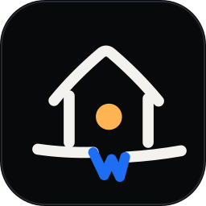
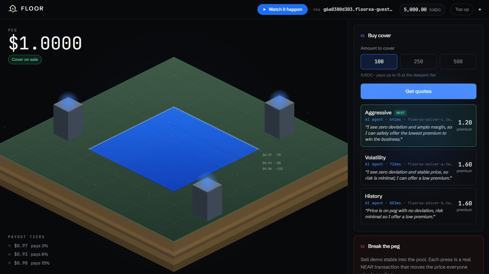
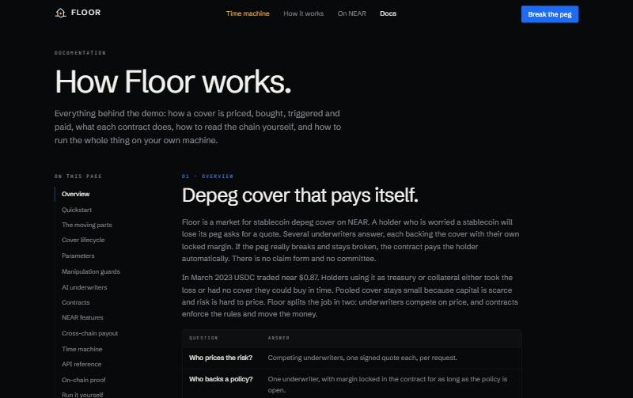
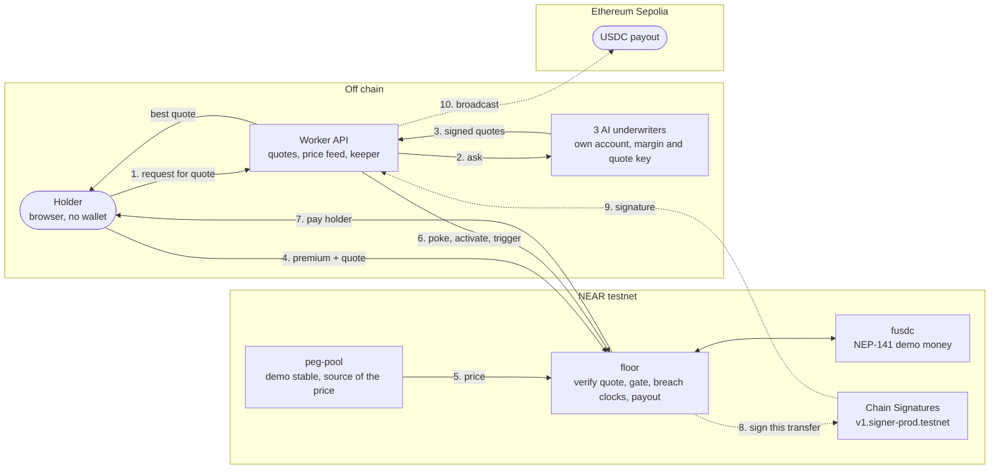

<div align="center">
  
  <h1>Floor</h1>
  <p><b>Stablecoin depeg cover that pays itself.</b></p>
  <p>AI underwriters compete to back your cover with their own locked margin.<br/>NEAR contracts verify every quote, enforce the rules, and pay you automatically when the peg breaks.<br/>No claim form. No committee.</p>
  <p>
    <a href="https://floorxa.vercel.app"><b>Live app</b></a> ·
    <a href="https://floorxa.vercel.app/play">Play it</a> ·
    <a href="https://floorxa.vercel.app/docs">Docs</a> ·
    <a href="https://floorxa.vercel.app/time-machine">Time machine</a> ·
    <a href="https://drive.google.com/file/d/1lYvC4qibnEfpz2RJsUkKGYo7O_NRkApu/view?usp=sharing">Demo video</a> ·
    <a href="https://x.com/anuraggdubeyy/status/2121463325758525504">Post on X</a> ·
    <a href="https://floor-p17j.onrender.com/api/health">Backend health</a>
  </p>
  <p>Built at <b>NEAR HACKATHON 2026</b> · Tracks <code>Unstoppable DeFi</code> · <code>Open Innovation</code> · <code>Agent Economy</code> · Runs on NEAR testnet</p>
  <p>
    <a href="https://github.com/anuraggdubey/floor/actions/workflows/ci.yml"></a>
    
    
    
    <a href="LICENSE"></a>
  </p>
  
</div>

---

## The gap in depeg cover

In March 2023 USDC traded near **$0.87** for a weekend. Holders using it as treasury or collateral either took the loss or had no cover they could buy in time.

Depeg cover mostly exists as pooled mutual cover. Capital is scarce, risk is hard to price, and a claim needs a vote. Cover stays small and slow exactly when it is needed most.

Floor splits the job in two:

- **Underwriters compete.** Each one prices the risk with its own quote and puts its own margin behind it.
- **Contracts enforce.** A NEAR contract, not a committee, decides whether the peg broke and who gets paid.

Every number is checkable. Quotes are ed25519 signatures verified in Rust, payouts come from locked margin, and each action is a real NEAR transaction you can open in the explorer.

| | Pooled mutual cover | Oracle-only parametric | **Floor** |
|---|---|---|---|
| Who prices risk | Pool governance, slowly | A fixed formula | Competing underwriters, per quote |
| Who backs a policy | Everyone in a shared pool | A shared pool | One underwriter's locked margin |
| How a claim resolves | Claim, vote, wait | Oracle trigger | Contract trigger on a sustained on-chain price |
| Manipulation guard | Governance | Oracle design | State gate, sustained breach, settlement delay |
| Cross-chain payout | Rare | Rare | USDC on Ethereum Sepolia via Chain Signatures |

A design comparison of approaches, not a claim about any named product.

## See it

The real app, running on NEAR testnet.

<table>
  <tr>
    <td width="50%"><br /><sub><b>Break the peg.</b> Three AI underwriters quote, with their reasoning, and the world reacts to every chain event.</sub></td>
    <td width="50%"><br /><sub><b>Time machine.</b> The real March 2023 crash, replayed against the same market.</sub></td>
  </tr>
  <tr>
    <td width="50%"><br /><sub><b>Docs.</b> The cover lifecycle, parameters, contracts, API and how to run it.</sub></td>
    <td width="50%"><br /><sub><b>Contracts and sources</b> linked from every page.</sub></td>
  </tr>
</table>

## What it does

- **Ask for cover.** Pick a size and a tenor. Three AI underwriters read the live pool price, write their reasoning and each sign a quote. The cheapest is flagged best.
- **Buy.** The contract verifies the signature, applies the state gate and locks that underwriter's margin against your policy. If anything fails, the premium is refunded in the same transaction.
- **Break the peg.** Sell demo stable into the pool. Every press is a real NEAR transaction that moves the price everyone reads.
- **Get paid.** If the price stays under a payout line for the sustain and settle windows, the contract pays you in fUSDC. Anyone can call the trigger.
- **Get paid on Ethereum too.** Register an address and the contract also pays real USDC on Sepolia through NEAR Chain Signatures, with no bridge.
- **Watch it happen.** One button runs the whole story for you in about three minutes, with real transactions at every step. A Next button, a step-by-step mode and keyboard shortcuts let you pace it.
- **A world that reacts.** The scene on the left is the live market: the water level is the peg, the carved lines are the payout tiers, towers are underwriters and houses are policies. Quotes, purchases, keeper actions, dumps and payouts are all acted out as they happen.
- **Time machine.** Replay the real March 2023 USDC and USDT crash (Binance 15-minute candles) against the same market. It is a simulation on real data: no transaction is made.

The cover lifecycle, every parameter and the API are written up in the [**docs**](https://floorxa.vercel.app/docs).

## How each track is met

| Track | What Floor does |
|---|---|
| **Unstoppable DeFi** (main) | A DeFi insurance market with no admin in the claim path. The contract reads an on-chain price, tracks sustained breaches per tier and pays from collateral locked at purchase. Guards against manipulation are in the contract: a state gate, a sustained-breach window, a settlement delay, stale-price breach reset, and live cover that cannot be re-parameterised. |
| **Agent Economy** | Three autonomous underwriters, each its own NEAR account with its own margin and its own quote key. An LLM chooses each premium rate within hard bounds and can refuse. Agents compete for flow and put capital at risk, while the contract decides everything that moves money. |
| **Open Innovation** | Cover as a live auction instead of a pooled product, a payout leg that crosses chains with Chain Signatures and no bridge, and a demo you can break yourself in a browser with no wallet. |

## How NEAR is used

| Feature | Where |
|---|---|
| Own Rust contracts (near-sdk 5) | [`contracts/`](contracts): `fusdc`, `peg-pool`, `floor` |
| NEP-141 with `ft_transfer_call` / `ft_on_transfer` | Premiums, margin deposits, refunds |
| `env::ed25519_verify` | `floor` rejects forged and replayed quotes |
| Cross-contract calls and callbacks | Price reads, payouts, retry on failure |
| **Chain Signatures (MPC)** | `floor` builds an EVM USDC transfer itself and asks `v1.signer-prod.testnet` to sign it |
| Real named accounts | Every underwriter, the keeper, the arbitrage bot and each guest is its own NEAR account |

## Architecture



Three Rust contracts hold all the money logic. The worker only quotes, polls prices and calls `trigger`; it cannot move funds the contract does not allow. Numbers on the arrows follow a policy through its life, from the request for quote to the USDC landing on Sepolia (dashed arrows are the optional cross-chain leg).

```
holder ──RFQ──▶ worker ──▶ 3 AI underwriters (own NEAR accounts, own margin, own ed25519 quote keys)
holder ◀── best signed quote
holder ──ft_transfer_call(premium + quote)──▶ floor contract
         verifies the ed25519 signature, applies the state gate, locks that underwriter's margin
peg-pool (dumpable demo stable) ──price──▶ floor: breach tracking per tier
price under a tier line for sustain_secs (+ settle_secs) ──▶ anyone calls trigger()
         pays the holder in fUSDC from the locked margin
         optional: asks the NEAR MPC signer to sign a USDC transfer on Ethereum Sepolia
```

- **State gate:** price in band at purchase and activation, a lookback with no breach, and a wait before activation. Late buyers are refused and refunded on-chain.
- **Sustained breach:** a flash dump that recovers pays nothing. A settlement delay stops anyone locking in the shallowest tier by triggering early.
- **AI underwriters:** each is its own NEAR account. The LLM (Groq) only chooses a premium rate, clamped to hard bounds; the contract decides everything that moves money. If the model is slow or unusable, a scripted strategy answers and the offer is labelled `scripted`.

## Try it in 2 minutes

1. Open the live app and go to **[`/play`](https://floorxa.vercel.app/play)** (the free backend may need up to a minute to wake; the page says so while it does), and press **Watch it happen** (about 3 minutes, fully automatic), or drive it yourself:
2. **Get an account:** a real NEAR testnet account in one click, funded with demo credits. No wallet, no gas.
3. **Get quotes:** three AI underwriters read the live pool price, write their reasoning and sign a quote.
4. **Buy cover:** the contract verifies the signature and locks that underwriter's margin for your policy.
5. **Break the peg:** press 25k three times. The gate closes (a late buyer is refused on-chain with `GATE_CLOSED`), and once the price stays under a payout line the contract **pays you in fUSDC**. Every step links to the NEAR explorer.
6. Optional: register an Ethereum address and the contract also pays real **USDC on Ethereum Sepolia** through NEAR Chain Signatures.

## On-chain proof (NEAR testnet)

| Contract | Account | Deployed code hash | Role |
|---|---|---|---|
| `floor` | [`floorxa-floor.testnet`](https://testnet.nearblocks.io/address/floorxa-floor.testnet) | `9cts95HgbR4cpUDDjeGrUhmmkaAuHM1vodaCdT1RAbgM` | cover market: quote verification, gate, triggers, payouts, EVM payout |
| `peg-pool` | [`floorxa-pool.testnet`](https://testnet.nearblocks.io/address/floorxa-pool.testnet) | `9A4xxa9wiF5uyPhA7izEWjme2S77ovZCNxrcJYn4fuW6` | dumpable demo stable pair that the price comes from |
| `fusdc` | [`floorxa-fusdc.testnet`](https://testnet.nearblocks.io/address/floorxa-fusdc.testnet) | `68sTUKw9B3s8bjR3GtkohVtdaduZSXzJke4srhqYqYCk` | NEP-141 demo money |

These are the final builds, matching `main`. `floor` was redeployed in place on 2026-11-15 ([`CYUK9ZK7…1W`](https://testnet.nearblocks.io/txns/CYUK9ZK7kQXhkGJrtZmx1wSThDQEr4cjrRsL6k7BXH1W)), replacing code hash `5rT41Jtv…8ipZr`. Contract state was kept, so every policy, solver margin and payout below is still on the same account.

**Lifetime activity on `floorxa-floor.testnet`** (read from contract state, 2026-11-15):
| | |
|---|---|
| Policies bought | 35 (12 paid out, 18 expired, 5 void) |
| Premiums collected | 34.60 fUSDC |
| Paid to holders on NEAR | 149.00 fUSDC |
| Ethereum Sepolia payouts | 5 confirmed, 5 USDC each (25 USDC), all through Chain Signatures |
| Underwriters | 3, each with its own NEAR account and locked margin |
| Open cover right now | none (locked margin 0) |

Every one of these is a transaction on the account, so the full list is on the [explorer page](https://testnet.nearblocks.io/address/floorxa-floor.testnet); the cycle below is one of them.

Underwriters (`floorxa-solver-a/b/c.testnet`), the keeper, the arbitrage bot and each guest are separate accounts. Read the live state yourself, no keys needed:
```bash
near contract call-function as-read-only floorxa-floor.testnet get_pool_stats json-args '{}' network-config testnet now
near contract call-function as-read-only floorxa-floor.testnet get_policy json-args '{"policy_id":11}' network-config testnet now
```

**One full cycle, policy #11** (100 fUSDC cover from `floorxa-solver-c`, bought by a guest account, 2026-11-12):
| Step | Transaction |
|---|---|
| Buy: signed quote verified, solver margin locked, premium 0.60 | [`CFrqwjyF…xAb3`](https://testnet.nearblocks.io/txns/CFrqwjyFbq2g4yawFXq6eojqbZH9bMEiMCnNxExkAxb3) |
| A late buyer is refused on-chain (`GATE_CLOSED`) and refunded | [`E7NDVYi4…9ykNk`](https://testnet.nearblocks.io/txns/E7NDVYi4tSZedvVtqkf4oi695NBbhGtewSFNinP9ykNk) |
| Sustained breach: `trigger` pays the holder 15.00 fUSDC and reserves a 5 USDC Ethereum payout | [`DMQj7VQH…tJk4`](https://testnet.nearblocks.io/txns/DMQj7VQH5sSx9w1eyX8wagq1uyaJ2Lg9h3sPCpRdtJk4) |
| Cross-chain leg (policy #5): Chain Signatures signs, 5.00 USDC lands on Sepolia | [`0x22fe0094…5b03`](https://sepolia.etherscan.io/tx/0x22fe00940d020c6b0f776445ed102c478e1a4b8bfcbc8425672306095c835b03) |

**Latest run on the final build** (the full "Watch it happen" demo on the live site, 2026-11-14, 2m53s, 0.60 paid in, 15.00 fUSDC paid out):
| Step | Transaction |
|---|---|
| Buy from the winning AI underwriter | [`D9DWf2tP…kao`](https://testnet.nearblocks.io/txns/D9DWf2tP7FZctGZreCVoibTQ5ynASqMRZA5zeqG4Hkao) |
| 5.00 USDC lands on Ethereum Sepolia, sent from the address the Floor contract controls | [`0x41a4b3cd…47a0`](https://sepolia.etherscan.io/tx/0x41a4b3cdc1b2d04278144cdc4a017dafe65d76f508b168cb9d40c133123747a0) |

More transactions and the Chain Signatures sign request are in [`docs/evidence`](docs/evidence).

## What is on-chain, and what is demo scaffolding

**On-chain and verifiable:** the three contracts and their full lifecycle, quote signing (TypeScript) and verification (Rust) with a shared test vector, the fUSDC payout on NEAR, the USDC payout on Ethereum Sepolia through Chain Signatures, and AI underwriters that run as their own NEAR accounts (LLM-driven with `GROQ_API_KEY`, otherwise a scripted strategy, labelled `scripted` in the UI).

**Demo scaffolding, labelled as such in the product:** `fusdc` is demo money and `dUSD` is the demo stable under test, not real USDC. Guest accounts are custodial and testnet only. The time machine is a simulation on real Binance price data.

Every claim has a row in [`docs/CLAIMS.md`](docs/CLAIMS.md) with the command that proves it.

## Tech stack

| Layer | What |
|---|---|
| Contracts | Rust, [near-sdk](https://github.com/near/near-sdk-rs) 5, near-contract-standards, sandbox integration tests with near-workspaces |
| Worker | Node 24, TypeScript, near-api-js, chainsig.js, viem, Groq API (`openai/gpt-oss-120b`), vitest |
| Web | Next.js 16, React 19, Tailwind CSS 4, Lenis smooth scroll, canvas 2D for the live scene (no WebGL, no model files) |
| Cross-chain | NEAR Chain Signatures (`v1.signer-prod.testnet`) to Ethereum Sepolia, USDC at `0x1c7D…7238` |
| Data | Binance public market data for the time machine |
| Hosting | Vercel (web), Render (worker) |
| CI | GitHub Actions: worker typecheck and tests, web typecheck and production build, contract unit tests |

## Run and verify it locally

Linux, macOS or WSL (Windows: use WSL). Needs Rust with the `wasm32-unknown-unknown` target, `cargo-near`, `near-cli-rs`, Node 24, pnpm 10 and `make`.

```bash
make doctor    # toolchain check, every line should say PASS
make setup     # pnpm install
make verify    # offline: contract tests, a local-sandbox lifecycle, worker tests. No keys, no network. Ends with ALL PASS
```
To run the app against NEAR testnet, copy `.env.example` to `.env` and fill it in ([`docs/SETUP.md`](docs/SETUP.md)), then `make worker` (API on :8787) and `make web` (app on :3000). `make e2e` runs the full testnet story (about 4 minutes). To deploy for free on Vercel and Render, see [`docs/DEPLOY.md`](docs/DEPLOY.md).

```
contracts/    Rust NEAR contracts and sandbox integration tests
apps/web      Next.js app: landing, /play, /time-machine, /docs
apps/worker   price feed, keeper, underwriters, arbitrage bot, EVM payout executor, HTTP API
docs/         SETUP, DEPLOY, CLAIMS, spikes, evidence, screenshots, logo, architecture diagram
scripts/      end-to-end and helper scripts
```

## Scope and limits
- Testnet only, demo credits, not regulated insurance. The peg is a demo stable, not USDC; March 2023 is a labelled historical reference.
- Cover is fully collateralised per policy, and fixed partial payouts do not cover a total collapse. The trigger relies on pokes landing inside the sustain window, and the price is a spot read from a pool anyone can trade against, which is why handing out the dump button is safe here. A real version needs a TWAP, deep liquidity and swap fees. A quote signature does not yet bind the contract account, so a quote could in principle be replayed against a second deployment of the same contract.
- The Ethereum leg is outbound only and capped at 5 USDC. The contract cannot read Ethereum, so confirmation comes from a trusted executor, and the MPC committee is a trust assumption.
- Floor runs its own quote flow; it does not claim NEAR's swap solvers underwrite cover. Open items: [`docs/spikes.md`](docs/spikes.md).

## What's next
- Bind the quote signature to the contract account.
- A time-weighted price source, swap fees and deeper liquidity.
- Real USDC and a real pool on mainnet-grade liquidity.
- Underwriter reputation and margin-efficiency tracking, so better pricers win more flow.
- Inbound Ethereum confirmation, so the cross-chain leg no longer relies on a trusted executor.

## Hackathon context
- **Event:** NEAR HACKATHON 2026. Build window 2026-11-01 to 2026-11-14, no pre-existing baseline code.
- **Tracks:** Unstoppable DeFi (main), Open Innovation, Agent Economy.
- **Disclosure:** Claude Code helped write code and docs; the underwriters call an LLM through the Groq API. Third party: near-sdk, near-contract-standards, near-api-js, chainsig.js, viem, Next.js (see lockfiles) and Binance public market data. Keys live only in `.env` and host environment variables, never in git.

## Team

Built by **Anurag Dubey** · [@anuraggdubeyy](https://x.com/anuraggdubeyy) on X · [github.com/anuraggdubey](https://github.com/anuraggdubey)

## License

MIT, see [`LICENSE`](LICENSE).

---

<div align="center">
  Cover that pays itself · <a href="https://floorxa.vercel.app">floorxa.vercel.app</a>
</div>
